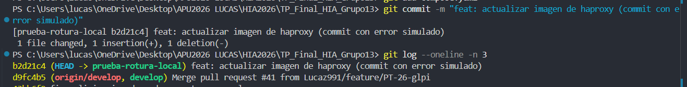
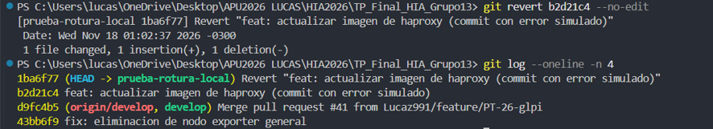

# Procedimiento de Rollback y Reversión de Fallos

Este documento establece los mecanismos para recuperar el sistema y mantener la alta disponibilidad en caso de fallos críticos durante el despliegue o la integración de código, cumpliendo con los lineamientos de CI/CD del TP Final.

## 1. Rollback de Código (Git)
Si un Pull Request introduce un error crítico en las ramas principales (`develop` o `main`), **está prohibido usar `git reset`** ya que altera el historial compartido y rompe el trabajo del equipo. 
El procedimiento oficial es utilizar `git revert`, el cual crea un nuevo commit que anula los cambios del commit defectuoso de forma segura.

### Paso a paso para revertir un fallo en Git:
1. Asegurate de estar en la rama donde ocurrió el error (`git checkout develop`).
2. Actualizá tu repositorio local: `git pull origin develop`.
3. Buscá el código (hash) del commit que rompió el sistema: `git log --oneline -n 5`.
4. Ejecutá la reversión automática usando ese hash: `git revert <hash> --no-edit`.
5. Subí la corrección al repositorio: `git push origin develop`.

**Prueba de concepto realizada:**
* Captura 1: Se detectó un commit con un error crítico introducido en el archivo de orquestación.

* Captura 2: Se aplicó `git revert` exitosamente, restaurando la estabilidad sin borrar el historial.

---

## 2. Rollback de Despliegue (Docker)
Si una nueva imagen de contenedor falla en el entorno de producción, el mecanismo de reversión es el siguiente:
1. Acceder a la terminal del servidor.
2. Abrir el archivo `compose.yaml`.
3. Modificar la etiqueta (tag) de la imagen afectada para apuntar a la última versión estable conocida (ejemplo: cambiar `app-backend:latest` a `app-backend:v1.9`).
4. Recrear el contenedor afectado sin apagar el resto del clúster:
   `docker compose up -d --force-recreate <nombre_del_servicio>`

---

## 3. Rollback de Base de Datos
Para fallos catastróficos a nivel de datos (ej. pérdida de registros o tablas), el clúster Patroni se apoya en backups automatizados y replicación. 
* **Procedimiento:** Detener el tráfico entrante desde el HAProxy (`docker compose stop haproxy`), restaurar el volumen principal de PostgreSQL desde el último snapshot válido, y reiniciar los nodos para que Patroni sincronice la versión sana.